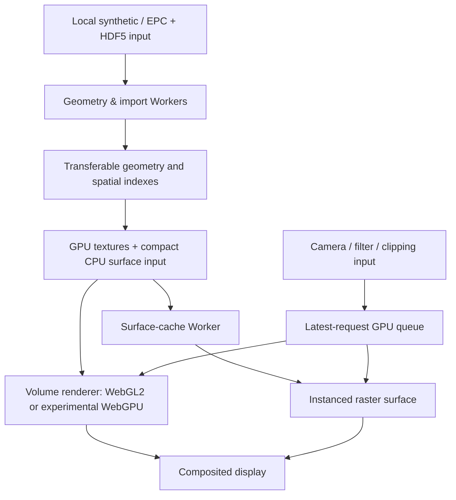

# Engineering Case Study: A Browser-Based 3D Visualization Engine

**Focus:** real-time interaction, GPU programming, memory-constrained data pipelines, asynchronous scheduling, and correctness testing.

This is a scientific-visualization engineering project built around irregular 3D grid data. The dataset happens to use reservoir geometry, but the engineering challenges are broadly applicable to CAD, digital twins, medical/scientific imaging, and other graphics-intensive web products.

> **What it demonstrates:** designing an end-to-end interactive system—not merely drawing a 3D object or using a graphics library.

## 1. The engineering problem

A useful visualization needs both accurate geometry and responsive interaction. Those goals conflict when a model contains millions of irregular cells:

- Accurate transparent volume rendering can require repeated ray–cell intersection and traversal.
- The data and supporting indexes consume substantial GPU and CPU memory.
- Filters, clipping planes, camera movements, and opacity changes can invalidate work already queued on the GPU.
- Fast-looking frames are insufficient if they mix old and new camera/filter state or silently simplify geometry.

The project supports **1M, 10M and 20M synthetic corner-point-grid configurations**, plus a documented subset of RESQML EPC/HDF5 imports. These are model sizes, **not measured real-time frame rates**. Device capacity still constrains which cases can actually load.

## 2. System architecture

Selected implementation entry points:

| Concern | Code |
| --- | --- |
| Ownership transfer, model data and indexing | [`dist/explicit-grid.js`](../dist/explicit-grid.js), [`dist/explicit-worker.js`](../dist/explicit-worker.js) |
| Local file ingestion | [`dist/resqml-worker.js`](../dist/resqml-worker.js), [`dist/resqml-import.js`](../dist/resqml-import.js) |
| In-flight work cancellation | [`dist/render-queue.js`](../dist/render-queue.js), [`dist/explicit-renderer.js`](../dist/explicit-renderer.js) |
| Surface extraction and rasterization | [`dist/surface-cache.js`](../dist/surface-cache.js), [`dist/surface-worker.js`](../dist/surface-worker.js), [`dist/surface-raster.js`](../dist/surface-raster.js) |
| WebGPU experiment | [`dist/webgpu-renderer.js`](../dist/webgpu-renderer.js) |
| Validation tooling | [`validation/`](../validation/) and root-level `validate-*.mjs` scripts |

## 3. Four decisions and their trade-offs

### Decision A — Separate interaction latency from final-frame fidelity

**Trade-off:** continuously ray-marching a large transparent volume during drag can block usable feedback; showing only a simplified preview forever would compromise the final result.

**Approach:** extract and cache the visible surface for responsive camera interaction, then compute the requested full volume when idle. The surface and volume paths use the same underlying grid data. The optional progressive path only presents completed tiles belonging to the current settings.

**Engineering signal:** optimize for *perceived responsiveness* and eventual accuracy as distinct requirements, with explicit transition and cancellation rules.

### Decision B — Keep only the latest requested GPU work

**Trade-off:** a queue of outdated renders wastes resources and can present incorrect state. Cancelling a GPU command already in flight is not the same as stopping a JavaScript promise.

**Approach:** [`LatestRenderQueue`](../dist/render-queue.js) increments a revision, resolves superseded pending requests, and checks cancellation between GPU batches. The renderers wait for GPU completion boundaries rather than issuing unlimited parallel jobs.

**Engineering signal:** concurrency control, state consistency, backpressure, lifecycle management—not just graphics.

### Decision C — Treat memory as a first-class architectural constraint

**Trade-off:** retaining all parsed geometry, worker arrays, GPU textures, and temporary framebuffer copies simultaneously can exhaust memory at larger scales.

**Approach:** transfer ArrayBuffer ownership between Workers and the main thread, release large CPU references after upload, reuse shared grid textures in the side-by-side comparison, and encode surface boundary selections compactly. When optional accelerators cannot allocate their textures, retain the baseline rendering path.

**Measured allocation context:** the repository documents approximately **424.5 MB of core GPU grid data for the 10M synthetic case** and **847.4 MB for 20M**, excluding several additional buffers, browser/driver overhead, and peak upload copies. These are not total VRAM requirements.

**Engineering signal:** explicit resource accounting and graceful fallback at scale.

### Decision D — Optimize without silently changing what is rendered

**Trade-off:** faster spatial search or an approximate first-hit shortcut can introduce missing foreground cells, especially near thin or subpixel geometry.

**Approach:** verify algorithmic changes against separate CPU geometric references and pixel comparisons, retain exact corner-point geometry, and reject shortcuts when correctness or reproducible gain is insufficient. The repository records an evaluated first-cell cache optimization that was not shipped.

**Engineering signal:** an evidence-based approach to performance work and willingness to discard a clever but unreliable optimization.

## 4. Evidence, not headline FPS

The existing technical README reports an optimization comparison with:

| Measurement | Context |
| --- | --- |
| **577.5 ms → 421.5 ms** median (about **27% lower**) | 10M synthetic cells, 1200 × 1000 output, software GLES/llvmpipe, warmed off-screen draw plus readback |
| **Byte-identical RGB output** | Same 1.2M-pixel test output before and after this optimization |
| **180 setting combinations** | Synthetic and RESQML numerical regression comparisons reported for an earlier ray-path change |

These results are *documented local test observations*, not independently rerun for this case study. **They do not establish browser responsiveness, discrete-GPU FPS, or a 27% user-visible speedup.**

Related validation scripts include [`validation/profile_explicit.py`](../validation/profile_explicit.py), [`validation/check_ray_optimization.py`](../validation/check_ray_optimization.py), [`validate-render-scheduling.mjs`](../validate-render-scheduling.mjs), and [`validate-webgpu-scheduling.mjs`](../validate-webgpu-scheduling.mjs). Some checks require local EGL/GLES or `wgpu` dependencies; the repository does not claim comprehensive browser end-to-end coverage.

## 5. Remaining limits

- Rendering arbitrary irregular corner-point grids still costs more than direct texture sampling from a regular Cartesian volume.
- WebGPU is an experimental option, **not a proven universal speedup** over WebGL2.
- Imported RESQML support is intentionally limited to specified versions and geometry encodings; arbitrary producer exports are not guaranteed.
- Transparent weighted surface blending is an approximation, not exact ordered transparency.
- Production-scale files and interactive FPS on the end user's discrete GPU still require device-specific measurement.

## 6. Transferable software-engineering capabilities

This work provides concrete examples for conversations about **staff/senior frontend engineering, graphics engineering, full-stack product engineering, and technical design**:

- Defining latency, correctness, memory, and graceful degradation as explicit product constraints.
- Designing data ownership, worker boundaries, and a cancellable async execution pipeline.
- Supporting two GPU backends without assuming that a new technology is faster.
- Evaluating optimizations with baselines, independent references, and documented limitations.
- Turning an R&D-heavy prototype into an inspectable engineering artifact.

**Interview-ready summary:** “I built an interactive browser visualization engine around large irregular datasets. The hard part wasn't only rendering; it was balancing responsiveness, exact geometry, memory pressure, and cancellation across workers and GPU jobs. I designed a hybrid surface/volume pipeline and validation harnesses that make trade-offs measurable instead of relying on visual impressions.”

For implementation details, dataset limitations, test matrices, and experimental histories, see the [original Chinese technical README](../README.md#显式角点油藏体渲染).
